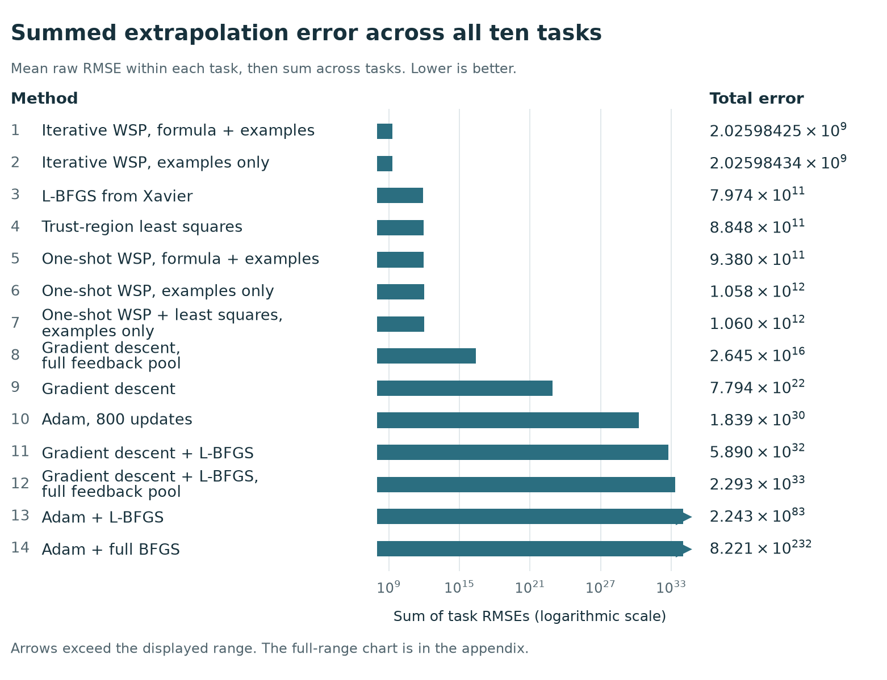
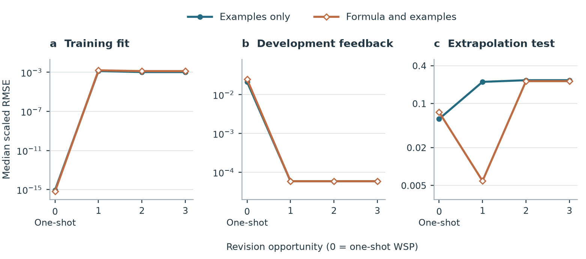

# WSP-for-turing-complete

**Weight-Space Programming and Gradient Optimization on Nonconvex Algorithmic Tasks**

Francois Chaubard and **Astra — AI research collaborator (GPT-6 Astra)**

[Read the paper](paper.pdf) · [LaTeX source bundle](output/preprint-source.zip) · [Blog post](https://fchaubard.github.io/weight_space_programming.html) · [Research bundle](output/research-bundle.zip) · [Detailed reproduction guide](REPRODUCIBILITY.md)

Can a language model write useful neural-network weights directly? This repository contains the experiments, saved weights, literal model requests and replies, analyses, figures, mathematical appendices, editable LaTeX, and final PDF for a study of **weight-space programming (WSP)**.

The repository name identifies the research direction. The measured benchmark is finite: it does **not** establish a solver for every Turing-computable function, prove that backpropagation cannot solve these tasks, or certify globally minimal architectures. This is a research preprint, not a conference acceptance.

## Experiments

- **Fixed networks:** ten tasks, 29 nonconvex task–architecture pairs, and three starts give 87 settings. We compare one-shot and iterative WSP, with either examples alone or formulas plus examples, against gradient-based optimizer pipelines.
- **Targets:** square, sine, positive self-power, hyperbolic tangent, addition, subtraction, running sum, sorting four values, Fibonacci numbers, and triangular numbers.
- **Iterative WSP:** at most three revision attempts, with training/development feedback and development-based selection. Test scores are computed after the selected weights are frozen.
- **Architecture selection:** 30 additional one-shot requests choose both a neural computation graph and its coefficients from examples. These trials report coefficient storage, live tensor memory, arithmetic operations, and failures separately from the fixed-network comparison.

The primary comparison matches the network, initial weights, and original training examples. Iterative feedback adds information; separate pooled-label gradient controls address this. Language-model pretraining and computational budgets are not matched.

## Findings and limits

Both examples-only WSP procedures match every binary64 extrapolation reference in **30 of 87 settings**. Full-batch gradient descent and gradient descent followed by L-BFGS achieve this in zero settings, although some numerical errors are very small. Exact agreement and root mean squared error (RMSE) are therefore both reported.

Iterative WSP has the lowest sum of task-mean raw extrapolation RMSE among the **14 complete optimizer pipelines**. The examples-only total drops from about **1.06 trillion to 2.03 billion**, largely through improved Fibonacci predictions. The median scaled extrapolation error worsens instead. Raw target magnitudes strongly affect the summed metric; this ranking is not a task-independent claim of optimizer superiority.



The revision curves expose another distinction: development gains do not guarantee extrapolation gains. The formula-assisted condition improves on extrapolation after the first revision opportunity and then regresses.



In the architecture trials, **28 of 30** proposals execute and **21 of 30** match every outer-test reference. Two invalid proposals remain failures. The permitted multiplication and hyperbolic-tangent operations make some targets directly representable; reported resource minima depend on that operator library and are not global optimality proofs. Familiar-function recognition may also contribute to the results.

## Reproduce without calling a language model

The pinned environment is documented in [REPRODUCIBILITY.md](REPRODUCIBILITY.md). The following checks replay saved observations; they do not train a model or request new responses.

```bash
python3 -m venv .venv
source .venv/bin/activate
pip install -r requirements.txt
python demo.py verify
python verify.py
python focus/learning_review/audit.py
python focus/learning_review/check_plot_data.py
python focus/learning_review/check_curves.py
```

To rebuild the paper, install `pdflatex` and `bibtex`, then run:

```bash
make paper
```

Alternatively, extract [output/preprint-source.zip](output/preprint-source.zip) and run `pdflatex paper.tex` twice. The bundle contains the figures and resolved bibliography. New model calls require access to the original model; they are different observations, not deterministic replays of the archived responses.

## Repository map

| Path | Contents |
| --- | --- |
| [paper.pdf](paper.pdf), [paper/](paper/) | Public preprint and editable manuscript |
| [focus/](focus/) | Matched optimizer benchmark, iterative histories, architecture trials, figures and independent audits |
| [writer/](writer/) | Original prompts, replies, model metadata and offline graders |
| [scalar/](scalar/), [sequence/](sequence/), [frontier/](frontier/) | Numerical constructions, sequence networks, proofs and controls |
| [extension/](extension/) | Additional studies, stress tests, synthesis and counterexamples |
| [revision/](revision/) | Analysis exports, release checks and supporting tables |
| [output/](output/) | Downloadable metrics, plots, standalone LaTeX and full research archives |
| [literature/](literature/) | References and related-work notes |

Useful data: [optimizer ranks](output/all-optimizer-raw-rmse-ranking.csv), [per-task contributions](output/optimizer-rmse-task-contributions.csv), [iterative endpoints](output/iterative-wsp-endpoints.csv), [recorded revision states](output/iterative-wsp-learning-curves.csv), and [architecture trials](output/architecture-choice-models.csv).

Earlier dated PDFs and historical controls are retained for provenance. **[paper.pdf](paper.pdf) is the current public paper.** Experimental replies contain final-answer numerical arrays and public construction explanations; they do not provide hidden internal reasoning traces.

## Attribution

Astra is credited as an AI research collaborator. Francois Chaubard is the responsible human corresponding author. The paper describes model assistance and distinguishes returned constructions from independently checked results.

The NeurIPS style file retains its original attribution, and numerical reference sources retain their source notes. No blanket reuse license is asserted for third-party material. A project-wide reuse license has not been selected.

```bibtex
@misc{chaubard2026wsp,
  author = {Chaubard, Francois and {Astra (AI research collaborator)}},
  title = {Weight-Space Programming and Gradient Optimization on Nonconvex Algorithmic Tasks},
  year = {2026},
  howpublished = {Research preprint},
  url = {https://github.com/Fchaubard/WSP-for-turing-complete}
}
```
