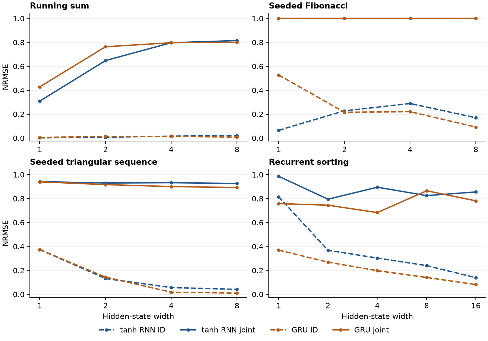

# Conventional recurrent networks on four sequence tasks

This extension trains ordinary tanh recurrent networks and gated recurrent units (GRUs) by backpropagation through time. Across two budgets, 204 unconstrained fits yielded zero complete exact matches on each 1,024-example test split. Several settings nevertheless fit the central distribution accurately. The longer-budget one-state tanh running-sum network had median inner NRMSE 0.00248, rising to 0.309 when both values and length changed. A one-state tanh network with a specified hidden scale learned an exact running sum from passive labels in three of five starts.

## Task interfaces

* **Running sum.** One scalar arrives per tick, and the readout emits the full prefix sum after every update. The target is sequential binary64 accumulation. The initial state is zero.
* **Seeded Fibonacci.** Two independent real values (a,b) initialize the trajectory at (y₀,y₁)=(a,b). Subsequent values follow yₜ₊₂=yₜ+yₜ₊₁. The initial state is tanh(E[a,b]+e). Each later tick has input zero. The readout includes the initial state as time zero. Varying the seeds gives independent numerical examples of a single recurrence. A separate diagnostic uses the classical seed (0,1) through index 64, with exact integer-valued binary64 labels on this range.
* **Seeded triangular sequence.** The initial value is a, and the first increment is b. Each tick adds the current increment to the value and then increases the increment by one. The model receives the seed pair and subsequent zero inputs exactly as in the Fibonacci task. Classical triangular numbers use (a,b)=(0,1). Generalized reference labels are rounded by the stated sequential updates.
* **Recurrent sorting.** A length-T list is encoded with T inputs (xᵢ,0). The model then receives T blank emission ticks (0,1). A single shared cell emits one scalar per blank tick, with output order ascending. The model receives the read/emit phase. It receives no ranks, pairings, attention, sorted feedback, or list elements during emission. All information about the list must pass through the final encoder state. The original five-hinge and 13-ReLU-per-comparator sorters use supplied sorting-network wiring and have a different architecture.

All standard models have one recurrent layer and a learned scalar affine readout. Parameters include the input and hidden weight matrices and both PyTorch bias vectors. For autonomous clocks, the stored zero-input channel has no effect on the forward trajectory. The standard PyTorch GRU has reset, update, and candidate rows. Each matrix or gate block is Xavier-uniform and biases start at zero. The encoder and head follow the same rule. We test widths 1, 2, 4 and 8, with 16 added for sorting. Unlike the main benchmark's homogeneous linear triangular realization, these models permit an affine bias for the unit increment.

## Data, selection, and reporting

Training lengths are 4, 6 and 8 for running sum and both seeded recurrences, and 2, 3 and 4 for sorting. A separate generated bank at each length contains 512 training and 160 validation examples. All values and seeds come from [−3,3]. There is no supervision from any outer distribution. The same data are paired across cells, widths and initialization seeds 101, 202 and 303. Each test split has 1,024 independently generated examples. Outer values independently sample a sign and a magnitude on (3,10]. For a seeded recurrence, range shift acts on the initial values. All metrics use every emitted time position.

| Split | Magnitudes | Length for sum or seeded recurrences | Sort arity |
|---|---|---:|---:|
| ID | central | 8 | 4 |
| Range only | outer | 8 | 4 |
| Length only | central | 32 | 8 |
| Joint | outer | 32 | 8 |

At each Adam update we uniformly select a training length and draw 64 examples with replacement. The objective is per-tick MSE normalized by the square of that position's empirical training RMS, floored at one. This keeps later Fibonacci outputs from dominating the fit. Adam uses learning rate 0.01 for the first 75% of updates and 0.003 for the rest, with gradient clipping at norm 5. Every 50 updates, selection evaluates all central validation lengths with equal weight. From the best checkpoint, full-batch L-BFGS uses strong Wolfe search and up to 35 or 200 optimizer iterations in the 1,000- or 5,000-Adam-step runs respectively. The lower validation-loss model between the polished candidate and the best Adam iterate is retained. The learning-rate switch means the longer run refits from the same start. The longer study's 200-iteration polish won 101/102 validation comparisons.

NRMSE is sqrt(sum squared prediction error / sum squared target), pooled across examples and time. Whole-output exactness requires numerical binary64 equality at every tick, treating signed zeros as equal. One-ULP and scaled tolerances are recorded separately. The initialized and fitted parameters are saved individually. Both budgets are reported with shared seed identities and paired evaluation data.

## Results

Each row below reports medians across three Xavier starts with the longer budget. Sums use width one, seeded sequences use two and sorting uses four. At these widths the full RNN/GRU slot counts are 6/14 for sum, 19/39 for seeded Fibonacci and triangle, and 37/101 for sort.

| Task | Cell | ID NRMSE | Range only | Length only | Joint |
|---|---|---:|---:|---:|---:|
| Sum | tanh | .00248 | .0514 | .0467 | .3094 |
| Sum | GRU | .00547 | .0999 | .0837 | .4288 |
| Fibonacci | tanh | .2283 | .6581 | .99998 | .9999955 |
| Fibonacci | GRU | .2163 | .6557 | .99998 | .9999955 |
| Triangle | tanh | .1316 | .5141 | .9046 | .9297 |
| Triangle | GRU | .1437 | .4972 | .9072 | .9165 |
| Sort | tanh | .3031 | .7769 | .6959 | .8945 |
| Sort | GRU | .1975 | .6235 | .4747 | .6827 |

A 16-state GRU improved sorting ID NRMSE to .0816 but had joint NRMSE .7811. All unconstrained models scored 0/1,024 whole sequences exactly on each of ID, range, length and joint at both budgets. These outcomes record the specified optimizer and parameterization. They give no unconditional bound on what gradient training can reach.



## Architecture and numerical mechanisms

For either recurrent cell, all hidden coordinates have magnitude at most one. For a particular saved affine readout, its output magnitude is bounded in real arithmetic by B=||v||₁+|bias|. The target values imply a resulting relative RMS floor by replacing every error with max(0,|y|−B). At width two, longer-budget Fibonacci RNNs and GRUs had median readout bounds 36.85 and 36.60 respectively. This alone forces nearly unit joint NRMSE. The corresponding triangular limits were 29.07 and 40.53, with error floors .9234 and .8947, close to observed .9297 and .9165. In sorting, the width-four tanh head allows a floor of .1783 versus observed .8945. There the head amplitude alone explains much less. Per-fit bounds and fractions of out-of-range targets are in `readout_bounds.csv`.

The central tasks impose different dimensional constraints over the reals. On seeded Fibonacci and triangle, the first two outputs have a nonsingular 2×2 Jacobian with respect to (a,b). A differentiable initial encoder of width d and decoder cannot have composite rank larger than d. Thus exact reproduction on an open set requires d≥2. For the specified sorting interface, restrict to strictly ascending input lists. Exact sorting then has Jacobian rank T, while the emitted list factors through a d-dimensional hidden state, requiring d≥T. This gives a necessary width threshold. Learned tanh and GRU maps are smooth, whereas sorting has kinks where two inputs coincide. These real-arithmetic arguments give no impossibility result on a finite binary64 test set.

The matched programmed tanh cell uses q=2⁻⁴⁰ for sum and triangle and q=2⁻⁵² for Fibonacci, with readout weight 1/q. Sum uses h←tanh(h+qx). Seeded cells encode q(a,b). The active transition is [[0,1],[1,1]] for Fibonacci and [[1,1],[0,1]] with second-coordinate bias q for triangle. Extra coordinates are zero. The GRU uses the same candidate weights and reset/update biases +1000 and −1000, which evaluate to exactly one and zero in the recorded binary64 sigmoid implementation. No integer rounding or test-time correction is applied. In both architectures, the width-one sum and width-two seeded programs match every test trajectory, including joint range and length. The classical Fibonacci program first fails at index 39, giving NRMSE 3.73×10⁻⁶ over indices 33–64. Hidden scaling therefore buys a finite operating range. No direct same-graph sorting program is claimed.

The additional passive control fits two independent Xavier scalars (a,b) in the single cell h←tanh(a h + q b x), y=h/q, fixing q and all biases. It uses the same training examples, dev selection and longer optimizer budget. At q=1 every run fails to match a single complete outer list. At q=2⁻⁴⁰ three of five runs land exactly on (1,1) and match all four splits completely. The other two give joint NRMSE 3.04×10⁻¹⁶ and 1.60×10⁻¹⁵. This is a scale-informed, restricted parameterization of a conventional tanh cell and demonstrates an exact passive backpropagation success.

## Reproduction and artifacts

Use Python 3.12.12, NumPy 2.5.4 and PyTorch 2.15.0 to replay the recorded CPU kernels. The figure also uses Matplotlib. From this directory:

```sh
python run.py --jobs 5
python run.py --jobs 5 --steps 5000 --polish 200 --output longer
python calibrated.py
python audit.py
python summarize.py --figure
```

`results.json` and `longer/results.json` store every split, optimizer selection, seed and parameter count. The two corresponding `weights.npz` archives contain original Xavier and final arrays. `audit.py` regenerates the inputs, checks initialization digests and recomputes every stored split metric for all 244 states, including the programmed controls repeated across two budgets. `summary.csv` retains min/median/max across seeds for every task, width, cell, split and budget. `calibrated.json` gives the ten scaled-control fits. CLI option `--cache DIRECTORY` allows resumption of a run with an unchanged implementation and budget.
